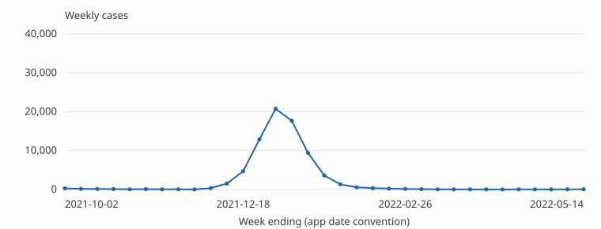
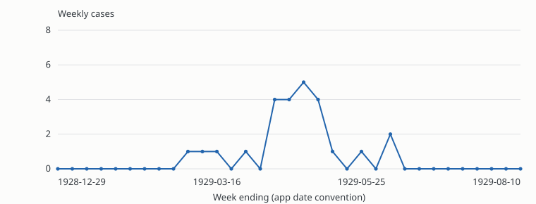
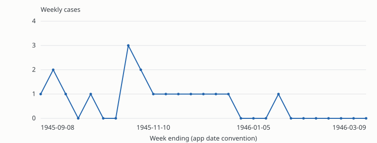
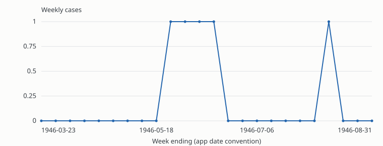
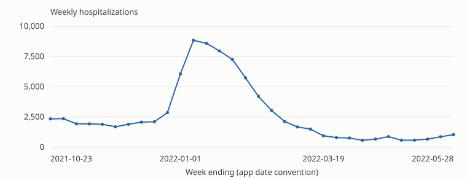
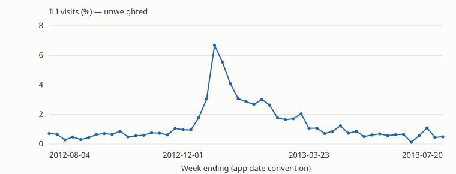

# IDOBE annotation tutorial and rubric

**Draft v0.1 · 2026-10-20 · For study-team review**

This is proposed study guidance, not a CDC-authored labeling protocol. The definition follows the
CDC references below; the response rules and confidence anchors are proposed for IDOBE.
The [seven-step wizard preview](tutorial/index.html) presents the same core guidance.
It is a local draft and does not write annotations or change the live application.

## Screen 1 — What are you judging?

**Does the evidence support disease occurrence above what would normally be expected for this time,
place, and population?**

Use the CDC concept of excess occurrence relative to an appropriate expectation. Identify:

- **Time:** the relevant dates and interval.
- **Place:** the geographic area or setting represented.
- **Population:** the people covered by the surveillance system or setting.
- **Expected occurrence:** a defensible comparator for that same context.

The CDC's two-week example is illustrative, not a universal duration requirement.
A curve need not have a single peak, a large absolute count, or a completed decline.
Conversely, a peak or a cluster alone does not establish an outbreak.
[CDC outbreak and case definitions](https://www.cdc.gov/urdo/php/surveillance/outbreak-case-definitions.html).

Your annotation is a judgment of the supplied evidence, not a declaration that an outbreak has been
confirmed by a public-health investigation. Apply the study's agreed scope consistently.

**Continue → Read the evidence**

## Screen 2 — Read the evidence before the curve

1. **Check the measure.** Cases, hospitalizations, and ILI percentages are different quantities.
   Hospitalizations and ILI percentages may provide supporting surveillance signals; do not silently
   treat them as disease-case counts. A proxy-only series needs an agreed interpretation for the study.
2. **Check time and place.** Read the axis, dates, disease, and location. A displayed week is a
   surveillance interval; do not assume it is the date of symptom onset.
3. **Identify the population.** Use the source's stated coverage. A state or country name does not
   establish complete population coverage or a shared exposure. Do not invent a school, facility,
   demographic subgroup, or denominator.
4. **Identify a comparator.** Prefer supplied historical or seasonal context for the same disease,
   place, population, and measurement system. Adjacent weeks may be useful if comparability is
   defensible, but the first or lowest point is not automatically “normal.”
5. **Check limitations.** Look for gaps, abrupt reporting changes, interpolation, unusual precision,
   and a window that starts or ends mid-event. Note the specific limitation rather than assuming its cause.

CDC guidance discusses comparison periods, reporting changes, and surveillance limitations when
establishing excess occurrence.
[CDC field investigation guidance](https://www.cdc.gov/field-epi-manual/php/chapters/field-investigation.html).

**Current interface limitation:** the app supplies a disease, location, measure, dates, and a short
series. It does not supply an explicit expected baseline, population description, or per-point
imputation flags. If your expertise provides a defensible comparator, state that basis in the comment.
If the missing context prevents deciding whether occurrence is above expectation, choose **Unsure**.
Do not manufacture a numeric threshold or treat missing context as evidence of no outbreak.

## Screen 3 — Choose your response

| Response | When to choose it | What it means |
|---|---|---|
| **Outbreak** | You can identify a defensible expectation and the available evidence favors occurrence above it. | A positive judgment, with confidence reflecting the evidence and its limitations. |
| **Not an outbreak** | You have enough interpretable context to judge that occurrence is consistent with expectation, or that a documented reporting artifact adequately explains the apparent excess. | A negative judgment for this series and context; it does not assert that no smaller local outbreak occurred. |
| **Unsure** | You reviewed the evidence but cannot make a defensible positive or negative judgment: the comparator is missing, explanations remain unresolved, or context is inadequate. | The evidence is indeterminate. This is an informative assessment. |
| **Skip** | You are not making an assessment: the item is outside your expertise, you need to stop, or a technical problem prevents inspection. | No scientific judgment is recorded. |

**Decision path:** Can I review this item? If no, Skip. If yes, can I make a defensible directional
judgment? If no, Unsure. If yes, choose Outbreak or Not an outbreak, then rate confidence.

**Unsure versus Skip:** “I examined it and cannot determine whether this exceeds expectation” is
Unsure. “I cannot assess this disease” or “the chart and table will not load” is Skip.
If the chart fails but the table is usable, you may still assess it.
Missing baseline information in an otherwise readable series usually calls for Unsure, not Skip.

**Low confidence versus Unsure:** choose a binary label at low confidence only when you can explain
why the evidence leans that way. If the choice would be arbitrary, choose Unsure.
Do not use Not an outbreak as a substitute for insufficient evidence.

In the current app, Skip removes the item from your ordinary queue; it is not a promise to show it
again later. You can reopen it from **My annotations**. Unsure requires a confidence value and counts
toward annotation coverage; Skip does not require confidence.

## Screen 4 — Rate confidence in your selected response

Confidence describes the strength of your judgment, not disease severity, case volume, or model
probability. These anchors are qualitative; the numbers are not calibrated probabilities.

| Score | Proposed anchor for Outbreak / Not an outbreak |
|---|---|
| **1 — Very low** | A weak but explainable leaning; major limitations could reverse it. Do not make a blind guess. |
| **2 — Low** | One interpretation is somewhat better supported, but substantial uncertainty remains. |
| **3 — Moderate** | A defensible interpretation with a meaningful unresolved limitation. |
| **4 — High** | Clear supporting evidence and a credible comparator; remaining limitations are unlikely to change the label. |
| **5 — Very high** | Compelling evidence with an appropriate comparator and no material unresolved limitation apparent in the supplied context. This is not absolute certainty. |

**For Unsure:** rate confidence that the available evidence is insufficient or ambiguous.
For example, Unsure + 5 can mean “I am very confident that the missing baseline makes this
unresolvable from the supplied information.” It does **not** mean “I am very confident this is an outbreak.”
Unsure + 1–2 means you are less certain whether a defensible directional judgment can be made.
This proposed convention needs to be taught explicitly because older ratings were collected without it.

**For Skip:** no confidence score.

**Suggested comment:** “Compared with [baseline and its basis], [specific evidence]. Main limitation:
[missing context / alternative explanation / none apparent].”

For Unsure, identify what would resolve the uncertainty. For a low-confidence binary label, explain
both the direction and the main doubt. For Skip, a brief reason helps distinguish expertise and
technical issues. These comments remain optional in the current app.

## Screen 5 — Discuss examples from existing annotations

### Provenance and use

The local database snapshot contains **61 current annotations on 61 distinct series**, from two
annotators overall. **44 ratings have confidence 4 or 5:** 37 Outbreak and 7 Not an outbreak.
Each series has only **one** annotator. There are **no existing Unsure or Skip annotations**.

The six examples below use the latest answer per annotator and series, selected at confidence ≥4.
The source records have no comments. The explanations below are proposed teaching interpretations,
**not recorded annotator rationales**. Older confidence values do not demonstrate compliance with this
new rubric. These examples are candidates for calibration discussion, not adjudicated ground truth.
The [example snapshot](tutorial/examples.json) records the source annotation IDs and plotted values
without annotator identities. Charts use the app's `start_date + 7 × index` date convention.

### A. A pronounced rise — COVID-19, Mozambique, #4690

**Recorded:** Outbreak, 5/5; annotation #39. Window: 2021-10-02 through 2022-05-14.
The first eight weekly values are 50–296. The series later reaches **20,747** in the week ending
**2022-01-01**, then declines.

**Teaching point:** a large, sustained departure from surrounding levels supports considering excess
occurrence. Ask whether reporting and population coverage are comparable and why surrounding weeks
are an appropriate reference. If those conditions are defensible, Outbreak is supported. Shape alone
does not establish them, and the recorded 5/5 should not be copied automatically.

### B. Small counts can still matter — Poliomyelitis, Florida, #3406

**Recorded:** Outbreak, 4/5; annotation #18. Window: 1928-12-29 through 1929-08-10.
Nine initial displayed weeks are zero; a later four-week run is **4, 4, 5, 4**.

**Teaching point:** absolute magnitude is not the definition. If the near-zero background is a
credible expectation for that historical setting, a small cluster can represent excess.
Do not introduce a universal minimum count or require a smooth bell-shaped curve.

### C. A candidate negative example — Poliomyelitis, New Mexico, #1426

**Recorded:** Not an outbreak, 5/5; annotation #43. Window: 1945-09-08 through 1946-03-09.
Weekly values range from **0 to 3**, with no pronounced sustained rise.

**Teaching point:** this can illustrate a negative judgment **if** low sporadic occurrence is
consistent with a credible baseline. “Few cases” and “no big peak” alone are insufficient.
If the historical expectation is unknown and prevents that determination, Unsure is appropriate
under the proposed rubric, even though the earlier annotation was confident.

### D. High confidence still needs review — Smallpox, Kansas, #7196

**Recorded:** Not an outbreak, 5/5; annotation #57. Window: 1946-03-23 through 1946-08-31.
There are five weeks at **1**, including four consecutive weeks; the remaining weeks are zero.

**Teaching point:** use this as a discussion case, not a canonical negative. The answer depends on
what was expected in Kansas in 1946 and whether the cases were linked. Do not apply today's disease
context retroactively. With insufficient historical context, Unsure is defensible.
High confidence is a property of a prior judgment, not independent validation.

### E. Identify the outcome — COVID-19, Georgia (GA), #9308

**Recorded:** Outbreak, 5/5; annotation #54. Window: 2021-10-23 through 2022-05-28.
The displayed hospitalization series peaks at **8,849** in the week ending **2022-01-08**.

**Teaching point:** this is a hospitalization signal. It is not 8,849 disease cases, nor evidence
of a specific shared exposure. Its use as evidence for a disease outbreak needs a stated proxy
policy and an appropriate hospitalization comparator. Without that basis, do not force a binary label.

### F. Recognize percentages and seasonality — ILI, Minnesota, #10778

**Recorded:** Outbreak, 5/5; annotation #33. Window: 2012-08-04 through 2013-07-20.
The displayed unweighted ILI visit percentage reaches **6.67769%** in the week ending **2012-12-29**.

**Teaching point:** an increase in a percentage is not directly a count increase and does not identify
a pathogen. A seasonal peak requires a suitable seasonal expectation before it supports an excess
judgment. This example is useful for teaching units and baseline choice, not “every winter wave is
an outbreak.”

## Screen 6 — Practice the distinctions

These are **hypothetical teaching scenarios**, not additional database annotations.
The numerical choices illustrate the proposed convention, not required answers to real series.

| Scenario | Suggested response | Why |
|---|---|---|
| You inspect a clear rise, but no defensible comparator is available and seasonality could fully explain it. | **Unsure, high confidence** if the insufficiency is clear. | You evaluated the evidence and identified the missing information needed to judge excess. |
| A credible comparator is available. An increase appears real, but an unresolved reporting change could explain part of it. You can explain why real excess is slightly better supported. | **Outbreak, 1–2**. | A defensible positive leaning exists, with substantial uncertainty. |
| Counts seem consistent with a supplied baseline, but incomplete reporting could conceal an excess. You can explain why the negative interpretation is slightly better supported. | **Not an outbreak, 1–2**. | A defensible negative leaning exists, with substantial uncertainty. |
| The disease or surveillance system is outside your competence. | **Skip; no confidence**. | You are declining to make a judgment. |
| Neither chart nor values table loads. | **Skip; no confidence**, with a technical note if possible. | The obstacle is access to the item, rather than ambiguity after review. |

## Screen 7 — Before submitting

- I checked the measure, time window, place, and available population information.
- I can explain the expected baseline, or I chose Unsure because I cannot.
- My label reflects excess relative to expectation, rather than shape or absolute size alone.
- My confidence describes my selected response.
- My comment identifies any consequential missing context or alternative explanation.

**Finish tutorial → Begin annotation** is proposed production copy. In this draft preview,
the final action only restarts the tutorial; no answer or completion record is saved.

## Study-team decisions before enabling this tutorial

1. Approve the operational interpretation of hospitalization and ILI series. Retain the CDC concept;
   explicitly distinguish proxy evidence from a measured disease-case excess.
2. Supply baseline/population/source context where available. A shape-only task would be a different
   annotation target and should not be silently substituted.
3. Adjudicate the examples under the new rubric. For each binary teaching example, document the
   comparator and why it supports the label. Retire examples that cannot meet this requirement.
4. Reserve approved tutorial examples outside the blinded evaluation pool. Revealing a prior answer
   changes the independence of subsequent ratings of that same series.
5. Version the rubric, record its version and tutorial completion alongside future annotations, and
   distinguish those answers from the existing uncalibrated ratings.
6. Keep Unsure visible as an unresolved human judgment. The current final-label export may use a model
   prediction when there is no binary expert majority; that is not resolution by an expert.

No historical annotations, confidence scores, queue rules, or model behavior were changed by this draft.
